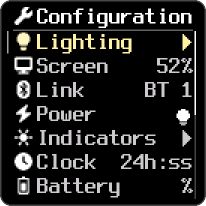
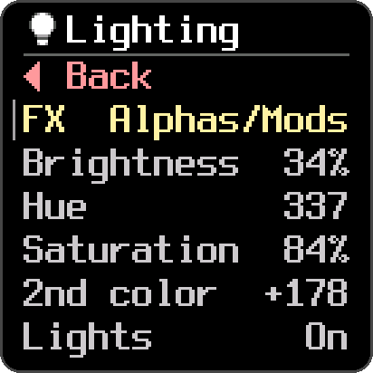
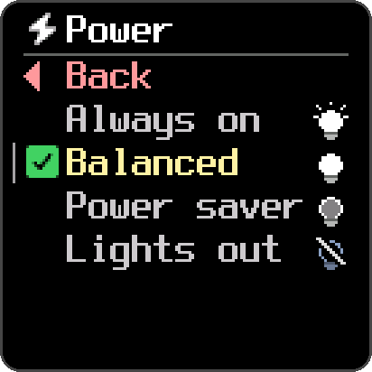
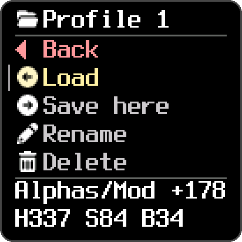
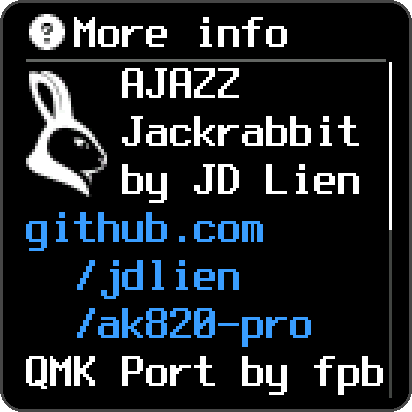

<p align="center">
  
</p>

# AK820 Pro — the "Jackrabbit" firmware

Replacement firmware for the **AJAZZ AK820 Pro**, built on QMK. It turns the
keyboard's 0.85″ screen into something you will actually look at: a clock
set from your computer to within milliseconds, the song that is playing, the
battery left in hours, and a menu for every setting, driven by the knob.
Remap anything in VIA from a browser. On battery, expect a week or more
between charges with the lights on, and two to four weeks in the
power-saving modes, from figures measured on the bench rather than guessed.

**[Download](https://github.com/jdlien/ak820-pro/releases)** ·
**[Battery calculator](https://jdlien.github.io/ak820-pro/power/)** ·
**[Get started](#get-started)** ·
**[Before you flash](#before-you-flash)**

It is a personal build, made for JD's keyboard and published for other
AK820 Pro owners, on top of [fpb](https://github.com/fpb)'s QMK port.

## What you get over stock

- **Media keys that work over Bluetooth**, and pairing that answers the first
  time you press it.
- **No dropped keys.** Every key is sampled at least every ~5 ms, and the
  firmware counts its own long passes: in everyday use, none reach 25 ms,
  the point where a press could be lost. You can read the counters on the
  screen (`Fn`+`D`).
- **No backlight flicker.**
- **A watchdog.** A wedged board recovers itself in ~12 s and says so on the
  screen, instead of needing a replug.
- **A screen worth having**, a menu, saved profiles and a real battery gauge,
  all below.
- **VIA**: remap keys, layers and the knob in Chrome or Edge, on any OS,
  with nothing to install.

## Features

### The screen

The dashboard shows the time, the track playing (artist, title, play or
pause and, where the player reports it, the time into the song), the battery
as a percentage, hours left or both, the connection (Bluetooth slot, 2.4G or
cable) and the Win/Mac side, and a band for the layer and the lock keys. The
menu and the song's text come in three faces: 8px, 10px, and 10px bold, the
default.

The clock and the song come from a small agent on your computer
([below](#now-playing-and-the-clock-wired-or-wireless)). Without it the
keyboard works normally, and the clock runs on its own.

### A menu on the keyboard

`Fn` + a click of the knob opens it. Turn to move, click to choose, hold to
go back. Every setting is here, so you never need software or a shortcut
list:

<p align="center">
  
  
  
  
</p>

- **Lighting:** the effect, brightness, hue, saturation and speed (or a
  second colour), each previewed live as you turn.
- **Screen:** the backlight, 1-100%.
- **Connection:** switch Bluetooth slots and pair a new device, with the
  pairing's progress on screen.
- **Power:** the four power modes ([below](#battery-life-measured)).
- **Indicators:** how bright the lock lights and the charging light are.
- **Clock:** 24 h or 12 h, with or without seconds, the date, or off.
- **Battery:** show the percentage, the hours left, or both.
- **Profiles**, **Font**, **Reset settings**, **Diagnostics** (system info
  and the health counters) and **Help** (the controls, the shortcuts, and a
  QR code back to this page).

Typing still works with the menu open, and it closes itself after a minute
idle. Screenshots are the firmware's own frames, rendered by its host test.

### Profiles

Save up to seven sets of settings: the lighting, the screen's level, the
indicators, the clock, the battery readout and the font. Resting on a
profile for 0.3 s previews it, and a profile can be renamed by typing on the
keyboard. Bind **Prof+** and **Prof-** in VIA to step through them with a key.

**Each side of the Win/Mac switch remembers its own settings.** Flip the
switch and the other side comes back as you left it, saved as a profile or
not.

### Battery life, measured

Most of the work in this firmware went here. The board itself cannot see its
battery: on battery its supply is a regulator's steady 3.9 V. The Bluetooth
module can, through a byte everyone had taken for a fake percentage, which
turned out to be a voltmeter on the pack, good to ~10 mV. A lithium cell's
voltage barely moves across much of its charge, though, so the firmware also
counts energy: it models its own draw second by second (each LED's colour
and brightness, the screen, the radio) and lets the voltage bound the count.
The model was calibrated against a current logger wired into the pack's
lead, over five full drains and charges.

What that gives you:

- **The battery in hours of use,** at the lighting you have now, not only a
  percentage.
- **Four power modes**, used on battery. On USB nothing sleeps.

  | Mode | What it does |
  |---|---|
  | Always on | Never dims or sleeps |
  | Balanced | Dims after 10 min idle, sleeps at 20 |
  | Power saver | Types at half brightness, dims after 1 min, sleeps at 3 |
  | Lights out | Keeps the lights and the screen dark, sleeps after 1 min |

- **A deep sleep at 3.2 mA**, about seven weeks untouched. A key wakes it,
  and the key you pressed still types.
- **A warning when the battery runs low.** At 0% the lights switch off, and
  about 5 hours of typing remain.

How long a charge lasts (Bluetooth, the screen dim):

| | 8 h of typing a day | 2¾ h a day |
|---|---|---|
| Balanced, every LED full white | 6½ days | 12½ days |
| Balanced, one colour at half brightness | 11½ days | 19 days |
| Power saver | 11 days | 3 weeks |
| Lights out | 2 weeks | nearly 4 weeks |

Eight hours means eight hours of nonstop typing, every day, which is more
than almost anyone does. 2¾ hours is JD's own logged use. The table is
modelled from measured parts. The measured figures behind it: 50-52 hours of
nonstop typing at full white, 15.6 Wh from full to 0%, and 9-10 hours to
charge.

**Try your own lighting, screen and mode in the
[battery calculator](https://jdlien.github.io/ak820-pro/power/).** What each
feature costs, and how all of it was measured: [docs/power.md](docs/power.md).

### Now playing and the clock, wired or wireless

`ak820-agent` is one small native program for macOS and Windows. It shows
the track playing on your computer and keeps the keyboard's clock right, and
it works in every connection mode:

- **over the USB cable**, the clock lands within a few milliseconds;
- **over the 2.4G dongle**, with the cable out;
- **over Bluetooth**, which has no data channel at all, by signalling through
  the keyboard's lock-light report (it never touches Caps Lock).

It reads the system's own now-playing service (MediaRemote on macOS, SMTC on
Windows), so Spotify, Apple Music, foobar2000 and any browser show up
without per-app support.

## What to expect

This is one person's firmware, tested on two boards. It is careful work, not
a product.

| | macOS | Windows | Linux |
|---|---|---|---|
| The firmware, VIA | ✓ | ✓ | ✓ |
| Building and flashing | ✓ | ✓ (MSYS2) | not tested |
| The agent (now playing, clock) | build it yourself | ✓ from [Releases](https://github.com/jdlien/ak820-pro/releases) | none |

- **VIA macros are effectively gone.** The profiles take the EEPROM's space,
  leaving VIA's macro buffer 19 bytes.
- **There are two panel revisions.** If the screen comes up upside down or
  colour-inverted, use the `-fpb` binary. Nothing is wrong with your board.
- **The battery figures come from one keyboard, one pack, at room
  temperature.** Another unit, an older pack or a cold room will differ.
- Known issues: [plans/BACKLOG.md](plans/BACKLOG.md).

## Get started

**Read [Before you flash](#before-you-flash) first**: save the stock image,
because once it is overwritten there is no reading it back.

### 1. Flash the firmware

macOS (Tahoe 26.x, Apple Silicon or Intel) with Homebrew, or Windows 11 from
the **MSYS2 MinGW 64-bit** shell (`winget install MSYS2.MSYS2`; not Git Bash,
not PowerShell):

```sh
git clone https://github.com/jdlien/ak820-pro && cd ak820-pro
./setup.sh                    # toolchain, pinned dependencies, flasher, tools
./build.sh daily              # or: ./build.sh fpb, for the other panel
./flash.sh ak820pro-builds/out/<the artifact it prints>
```

**Prebuilt instead:** take `ak820pro-via.bin` (or `-fpb.bin`) from
[Releases](https://github.com/jdlien/ak820-pro/releases) and run
`./flash.sh path/to/ak820pro-via.bin`. You still need the clone and
`./setup.sh`, which builds the flasher and the tools; you skip the compile.

`flash.sh` backs up your keymap, profiles and settings, asks you to press
`Fn`+`Esc` for the bootloader, flashes, and restores them.
**From stock, the first time,** put the board in the bootloader by hand (see
below) and add `--no-backup`, since stock has nothing to back up.

Then write the screen's fonts and icons, once, and power-cycle the board
afterwards (slider to `cable`, unplug ~10 s):

```sh
./time-util-ak820pro/ak820ctl flash write 0x0CE0000 assets-src/current/flash_assets.bin
```

Windows has four traps that all look like something else (CRLF, the venv's
name, `PATH` order, a macOS-only flag). They are written up in
[docs/hardware.md](docs/hardware.md#building-and-flashing-on-windows-msys2).

### 2. Install the agent

**Windows:** take the zip from
[Releases](https://github.com/jdlien/ak820-pro/releases), unzip it anywhere,
and from a terminal in that folder (not elevated):

```powershell
.\ak820 install --clock --radio --lockchan
```

**macOS:** no build is published yet, so build it from the clone (Rust
needed):

```sh
(cd ak820-agent && cargo build --release)
scripts/build-helper-macos.sh
ak820-agent/target/release/ak820 install --clock --radio --lockchan
```

`--clock` keeps the clock, `--radio` sends the song over the 2.4G dongle and
`--lockchan` over Bluetooth; leave off what you don't want. `install` copies
the program into place and starts it at every login (a per-user Scheduled
Task on Windows, a LaunchAgent on macOS). On macOS, `--lockchan` needs
**Input Monitoring** for `ak820-agent` (System Settings, Privacy &
Security). An unsigned build is asked for Automation consent again after
every rebuild. [`ak820-agent/INSTALL-macos.txt`](ak820-agent/INSTALL-macos.txt)
has the details.

```sh
ak820 status      # running? the last sync and push, the board's health
ak820 probe       # what the system says is playing; touches no keyboard
ak820 uninstall   # stop and remove it
```

The installed copy is not on `PATH`: it lives in
`~/Library/Application Support/ak820pro/bin` on macOS and
`%LOCALAPPDATA%\ak820pro\bin` on Windows (from PowerShell,
`& "$env:LOCALAPPDATA\ak820pro\bin\ak820.exe" status`). Give the clock ~15
minutes after installing: it slews rather than jumping, and learns the USB
timing as it goes.

### 3. Remap in VIA

The board is not in VIA's public list, so hand VIA the definition once per
browser:

1. Plug in the USB cable (the slider position does not matter), and **stop
   the agent** while you use VIA (`ak820 uninstall`; `install` again after).
   Two programs talking to the board at once can each get the other's
   replies.
2. In **Chrome or Edge**, open [usevia.app](https://usevia.app), click
   **Authorize device** and pick the AK820 PRO. VIA says it could not find a
   definition. That is expected.
3. Settings (the gear) → turn on **Show Design tab**. Design (the
   paintbrush) → **Load Draft Definition** → `via.json`, from
   [Releases](https://github.com/jdlien/ak820-pro/releases) or
   `qmk_firmware-ak820pro/keyboards/a_jazz/ak820pro/via.json` after
   `./setup.sh`.
4. Re-select the keyboard. Configure now works: keymap, layers, knob,
   lighting.

The layers are `WINBASE=0, WINFN=1, MACBASE=2, MACFN=3`, and the Win/Mac
switch picks the base, so a remap usually belongs on **both 0 and 2**.
`flash.sh` keeps your keymap across flashes. To save it yourself:
`hostagent/ak820keymap.py dump`.

## Shortcuts

The menu covers all of these. They are here for speed.

| Keys | Does |
|---|---|
| `Fn` + knob click | Open or close the menu |
| `Fn`+`Q` / `W` / `E` | Bluetooth slot 1-3 (hold 2 s to pair) |
| Slider | Bluetooth / 2.4G / cable |
| `Fn`+`←` / `→` | Hue |
| `Fn`+`↑` / `↓` | Brightness |
| `Fn`+`6` / `7` | Saturation |
| `Fn`+`-` / `=` | Effect speed (second colour on Alphas/Mods) |
| `Fn`+`\` | Next effect |
| `Fn`+`X` | Lights on/off |
| `Fn`+`PgUp` / `PgDn` | Screen brightness |
| `Fn`+`Home` | Screen on/off |
| `Fn`+`C` | Clock format |
| `Fn`+`B` | Power mode |
| `Fn`+`D` | Health page (hold to reset its counters) |
| `Fn`+`Esc` | Bootloader |

## Before you flash

1. **Download the stock image first.** It cannot be read off the board, so
   this download is your only way back. Get
   `AJAZZ_AK820PRO_PID_8009_V1.13_SN32F290.bin` from
   [fpb/ajazz-ak820-pro](https://github.com/fpb/ajazz-ak820-pro)
   (`StockFWBinaries/`):

       shasum -a 256 AJAZZ_AK820PRO_PID_8009_V1.13_SN32F290.bin
       cd0b01e30cb727d658a540922d1fb153bcfaa3da2ac97902ba547af9e97012ab

   Not v1.14: it changes the USB id, and AJAZZ's own software stops seeing
   the board.
2. **From stock, the first time,** the bootloader needs the 2-pin header
   under the spacebar shorted while the board powers up, with the slider on
   `cable`. fpb's repo has the photo. After that, `Fn`+`Esc` or `flash.sh`
   does it.
3. **The bootloader looks exactly like a dead keyboard:** a
   `BOOTLOADER / 0C45:7140` splash, then dark, no typing. That is normal.
   Look for USB id `0C45:7140` (macOS:
   `ioreg -p IOUSB -w0 -l | grep -c '"idProduct" = 28992'`), and recover by
   re-running the flash, not by power-cycling.
4. **A flash erases the board's settings.** `flash.sh` backs up the keymap,
   the profiles, the lighting and the live settings, and refuses to flash if
   a backup fails. It also refuses on battery once the battery is at 0%. The
   Bluetooth slot and the clock's trim come back on their own.

## Troubleshooting

- **Keys feel slow or go missing:** open `Fn`+`D`. If `rowgap` is in single
  digits and `stall>25` is 0, the firmware is fine; look for a program on
  the computer polling the keyboard.
- **VIA misbehaves, or the agent logs failed pushes:** both are talking to
  the board. Stop one.
- **The clock is off:** check the computer's clock first. Windows syncs
  only every ~9 hours out of the box (`w32tm /resync`).
- **Nothing playing on the screen:** `ak820 probe` shows what the system
  reports. On macOS over Bluetooth, check Input Monitoring.
- **The board went dark mid-flash:** it is in the bootloader. Re-run
  `flash.sh`.
- **The board reset when you moved the slider:** the slider switches the
  power source, and most flips reboot the board. That is the hardware.
- The agent's log: `~/Library/Logs/ak820pro/ak820-agent.log` on macOS,
  `%LOCALAPPDATA%\ak820pro\ak820-agent.log` on Windows.

## For developers

[`CLAUDE.md`](CLAUDE.md) has the working notes for changing things, and
[`docs/`](docs/) the topic docs: wireless, display, fonts and assets, clock,
LEDs, hardware, the MCU, battery, power, the test bench.

| Path | What |
|---|---|
| [`docs/`](docs/) | The topic docs; [`docs/power.md`](docs/power.md) is the battery-life reference |
| [`site/`](site/) | The [battery calculator](https://jdlien.github.io/ak820-pro/power/), published from `main`; its numbers come from the firmware's power model (`scripts/power_model.py`) |
| [`ak820-agent/`](ak820-agent/) | The agent: one Rust daemon for macOS and Windows |
| [`hostagent/`](hostagent/) | The tools `flash.sh` uses: keymap, lighting and profile backups, the battery log, the health counters |
| [`scripts/`](scripts/) | Bench and test tooling, generators, the VIA sync check |
| [`assets-src/`](assets-src/) | The fonts, the splash and the screen's asset image |
| [`plans/`](plans/) | Live work, known issues, designs |
| [`history/`](history/) | Measured results and audits worth keeping |
| `qmk_firmware-ak820pro/` | The firmware, cloned by `setup.sh` at the commit [`deps.lock`](deps.lock) pins |

The firmware is the
[`ak820pro-jdlien`](https://github.com/jdlien/qmk_firmware/tree/ak820pro-jdlien)
branch of a QMK fork; the board lives in `keyboards/a_jazz/ak820pro/`. Its
ChibiOS patches are commits on
[`jdlien/ChibiOS-Contrib`](https://github.com/jdlien/ChibiOS-Contrib/tree/ak820pro-patches).

## Credit

fpb did the original port, the CH582F protocol reverse-engineering, the
hardware documentation, and the macOS Tahoe flasher fix. This fork is board
hardening, the screen, the menu, the battery work, clock sync and the agent
on top of that.
[`ak820pro-builds/UPSTREAM-CONTRIBUTIONS.md`](ak820pro-builds/UPSTREAM-CONTRIBUTIONS.md)
sorts what belongs upstream from what is personal preference.

[quill4gen7](https://github.com/quill4gen7) proved the idea behind the
wireless data channel in the
[`notify` branch](https://github.com/quill4gen7/ak820-pro/tree/notify) of a
fork of this repo: toggling the lock lights as data bits to get data from
the computer to the board, from Linux over the 2.4G dongle. Our channel is a
separate implementation, but we would not have tried it without that proof.
The raw-HID jump to the bootloader came from the same fork.

The screen's faces are [Cozette](https://github.com/slavfox/Cozette) (MIT),
[Terminus](https://terminus-font.sourceforge.net/) (SIL OFL 1.1) and
[Iosevka](https://github.com/be5invis/Iosevka) (SIL OFL 1.1).

<p align="center">
  
</p>

QMK is GPLv2. No warranty: this is one person's keyboard firmware, published
in case it is useful to someone with the same keyboard.
